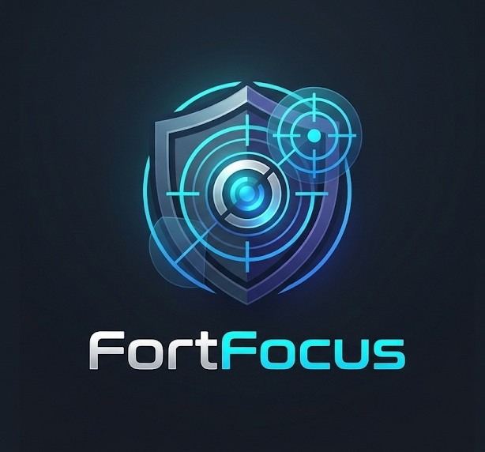

<p align="center">
  
</p>

<p align="center">
  
  
  
  
  <a href="https://www.instagram.com/fortfocus.official/"></a>
</p>

# FortFocus — Fortified Productivity & Focus Enforcement for Windows

**FortFocus** is an advanced, tamper-resistant desktop productivity and focus enforcement suite for Windows. Designed for professionals, developers, and students who require uncompromising concentration, FortFocus combines deep OS-level distraction blocking with an intelligent, voice-enabled companion architecture.

---

## Key Features

- **Hardened Distraction Blocking**
  - **Application Guard:** Blocks games, social media clients, and distraction executables during active sessions.
  - **Web Barrier:** Blocks distracting domains and websites at the network layer without requiring intrusive browser extensions.
  - **Tamper-Resistant Windows Service:** Runs as a dedicated background Windows service (`fortfocus-service`), ensuring focus enforcement cannot be trivially bypassed via Task Manager or process termination.

- **JIMMY — Intelligent Focus Companion Architecture**
  - **Holographic Interactive Avatar:** Real-time animated state visualizer responding to your productivity rhythms.
  - **Offline Voice Recognition:** Powered by embedded native Whisper (`whisper.cpp`) for fast, private, 100% offline speech-to-text.
  - **Adaptive Coaching & Guidance:** Integrated natural-language AI abstraction (Google Gemini & Groq) providing personalized work-session breakdown, focus coaching, and task tracking.
  - **Hardware DPAPI Encryption:** All optional AI credentials are encrypted using Windows Data Protection API (DPAPI) and never stored in plaintext.

> [!NOTE]
> **JIMMY AI Roadmap Status (v0.13.0)**  
> The core local distraction blocking, Windows background service guard, and timer scheduling in version `0.13.0` are fully active and operational. **JIMMY AI** conversational coaching and voice companion features are currently dormant/inactive in this initial release and will be officially activated in an upcoming update in a few months.

- **Configurable Session & Break Scheduling**
  - Flexible session lengths (Pomodoro or custom deep-work blocks).
  - Enforced rest intervals with automated break transitions.
  - Non-distracting system tray controls and real-time session HUD.

---

## System Requirements

| Specification | Requirement |
| :--- | :--- |
| **Operating System** | Windows 10 (64-bit, Version 1903+) or Windows 11 (64-bit) |
| **Architecture** | x86_64 / x64 |
| **Privileges** | Administrator rights (required once during setup to install the background service) |
| **Memory (RAM)** | 4 GB minimum (8 GB recommended when using voice recognition) |
| **Disk Space** | ~250 MB free space |
| **Network** | Offline-capable (Internet required only if enabling cloud AI coaching features in future updates) |

---

## Download & Verification

All official binaries are signed cryptographically via published SHA-256 digests and available in the **[Releases](https://github.com/FortFocus/FortFocus/releases)** tab.

### 1. Main Application Installer (`FortFocusSetup-0.13.0.exe`)
Download the primary production installer:
- **Installer:** [`FortFocusSetup-0.13.0.exe`](https://github.com/FortFocus/FortFocus/releases/download/v0.13.0/FortFocusSetup-0.13.0.exe)
- **Checksum File:** [`FortFocusSetup-0.13.0.exe.sha256`](https://github.com/FortFocus/FortFocus/releases/download/v0.13.0/FortFocusSetup-0.13.0.exe.sha256)

#### Checksum Verification:
```powershell
Get-FileHash -Algorithm SHA256 .\FortFocusSetup-0.13.0.exe
```
Expected SHA-256 digest:
```text
d1529e53544e249b1ba688d1be231e86a5b4b5c4145df48bef9667e5707e2592
```

---

### 2. Emergency Recovery Utility (`FortFocusRecovery.exe`)
For user safety during deep lock sessions, a standalone emergency recovery utility is published alongside the installer. In `v0.13.0`, `FortFocusRecovery.exe` supports **Emergency Unlock** and **Service Disarm** if you need to safely disarm the background service or exit an active lock state:
- **Recovery Binary:** [`FortFocusRecovery.exe`](https://github.com/FortFocus/FortFocus/releases/download/v0.13.0/FortFocusRecovery.exe)
- **Checksum File:** [`FortFocusRecovery.exe.sha256`](https://github.com/FortFocus/FortFocus/releases/download/v0.13.0/FortFocusRecovery.exe.sha256)

#### Recovery Instructions:
1. **Download:** Download `FortFocusRecovery.exe` from the Releases section.
2. **Run as Administrator:** Right-click `FortFocusRecovery.exe` and select **Run as administrator** (required to manage Windows background services).
3. **Bypass SmartScreen (if prompted):** If Windows SmartScreen appears, click **More info** followed by **Run anyway**.
4. **Choose Recovery Mode:** Follow the on-screen options to select either **Emergency Unlock** (to immediately clear active lockouts) or **Service Disarm** (to safely stop and disarm the background service).

> [!TIP]
> **Portable USB / External Storage Tip**  
> Because `FortFocusRecovery.exe` is a completely standalone executable requiring no installation or external dependencies, you can keep a copy on a **USB pen drive or any external storage device**. This ensures you always have immediate physical access to emergency unlock and disarm capabilities even during strict lock sessions.

#### Checksum Verification:
```powershell
Get-FileHash -Algorithm SHA256 .\FortFocusRecovery.exe
```
Expected SHA-256 digest:
```text
509c6f001137e1e0d62749ac96a9d659f661a5174f767377652fd555d346a3ba
```

---

## Installation & Setup

1. **Launch Installer:**  
   Run `FortFocusSetup-0.13.0.exe`.
2. **User Account Control (UAC):**  
   Click **Yes** when prompted to allow FortFocus to register and start the background enforcement service.
3. **Follow the Setup Wizard:**  
   Choose your installation directory and finish installation.

> [!NOTE]
> **Windows SmartScreen Notice**  
> Because FortFocus is a newly released independent application, Windows SmartScreen may present a blue dialog stating *"Windows protected your PC"*.
> 1. Click **More info**.
> 2. Click **Run anyway**.
> 
> *FortFocus executables are strictly audited, non-telemetry, and clean of third-party bundlers or adware.*

4. **Launch Application:**  
   Once setup completes, FortFocus will start in your Windows notification tray and display the dashboard.

---

## Quick Start Guide

1. **Configure Your Blocklist:**
   - Open FortFocus and navigate to the **Blocking** tab.
   - Add distracting applications (e.g., `discord.exe`, `steam.exe`) or target domains (e.g., `youtube.com`, `reddit.com`).
2. **Start a Focus Block:**
   - Set your session timer (e.g., 25 or 50 minutes) and click **Start Focus Session**.
   - Your blocklist is immediately activated and protected by the background service.
3. **Emergency Disarm & Unlock:**
   - If you need to stop an active session early in an emergency, run `FortFocusRecovery.exe` as Administrator to disarm the service and unlock immediately.

---

## Privacy & Security

- **Local-First Architecture:** All timers, application blocks, and speech recognition engines execute entirely on your local machine.
- **Zero Telemetry:** FortFocus does not transmit telemetry, tracking cookies, or usage analytics.
- **Hardware-Backed Encryption:** Any API keys provided for cloud LLM features are protected by Windows DPAPI encryption keys tied to your Windows user account.

---

## Community & Updates

Follow our official social channel for product updates, feature previews, and upcoming JIMMY AI announcements:
- **Official Instagram:** [@fortfocus.official](https://www.instagram.com/fortfocus.official/)

---

## Support & Vulnerability Disclosure

If you encounter an issue or wish to report a security vulnerability, please refer to our [Security Policy](SECURITY.md) or open an issue on the [GitHub Issues](https://github.com/FortFocus/FortFocus/issues) page.
